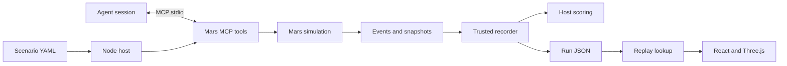

# Architecture

The local Node host owns one Mars simulation per MCP process. The scripted runner spawns that host and connects using the official SDK `Client` and `StdioClientTransport`. The host registers tools using `McpServer` and connects `StdioServerTransport`. Initialization, discovery, input validation, calls, and results travel through real MCP JSON-RPC. No HTTP runtime is needed for the static replay viewer.



The research layer sits beside the deterministic host rather than inside the world rules:

```text
Experiment Orchestrator → scenario variant → MCP session → Run JSON
                       ↘ public Reflection → Strategy Artifact → next attempt
```

The independent Standard Arena path adds a versioned benchmark and cost gate:

```text
Benchmark config → dry-run estimate → Budget Policy → clean MCP runs
                                                   ↘ verified model result → official leaderboard
```

## Decisions

1. **Small pnpm workspace, source exports.** TypeScript packages export source for local `tsx`, Vite, and Vitest. They are not yet independently published libraries. A single root typecheck verifies boundaries and applications.
2. **Mars-specific state contracts.** No universal world framework or hypothetical model adapters. Arena core contains only the shared contracts actually used by this slice.
3. **One-second deterministic ticks.** Tool latency is explicit. Actions are atomic; transit safety is conservatively forecast before transfer, with visual interpolation during recorded latency. See simulation semantics.
4. **Dual recording: events plus snapshots.** Events explain cause; complete frames make seek and replay independent of engine evolution or provider availability. Artifacts are intentionally observer-visible and not agent inputs.
5. **MCP observations are projections.** Public telemetry and inspection responses never serialize the full state or scenario. Scoring, future hazards, and true leak rates remain host-private. There are no hidden-state MCP resources.
6. **Static viewer.** Runs ship as public JSON assets. There is no live control API, account service, or database. The local runner uses the stdio server with scripted, Ollama, OpenAI, and compatible providers. Three public incidents share the existing Mars contract.
7. **Procedural visual assets and bundled fonts.** No downloaded colony models/textures, rendering service, or asset-license dependency beyond font licenses.
8. **Official SDK v1.32.1.** The working v1 API is pinned for a reproducible stdio boundary. Patched transitive overrides are documented in `pnpm-workspace.yaml`; review them when upstream resolutions include those fixes. Reference: [official v1 server documentation](https://ts.sdk.modelcontextprotocol.io/server) and [client documentation](https://ts.sdk.modelcontextprotocol.io/client).
9. **External learning artifacts.** Experiments, reflections, and strategy versions are serializable files. They can influence a later attempt only through an explicit adaptive input; no source code, simulator rule, hidden score, or model weight changes during an experiment.
10. **Bounded official evaluation.** `mars-standard-v1` fixes seeds and evaluator identity. `@arena/benchmarking` owns budget reservations, token/cost aggregation, pricing snapshots, result reuse checks, and derived leaderboard ranks. A public replay reads stored JSON and never invokes a model.

## Trust boundary

The agent receives tool schemas, the public briefing, and tool results only. The evaluation host and spectator viewer receive the scenario, events, complete world snapshots, and final score. Recording paths are host environment configuration and cannot be queried or supplied through tools. Each accepted tool result awaits host recording completion. Stdio stdout contains protocol messages exclusively.

## Local model integration

`apps/server/src/run-local.ts` uses `AgentSession.connect`, discovered tool schemas, and MCP calls in a bounded model loop. The model chooses tool names and JSON arguments; the host owns consequences. The runner loads the public briefing adjacent to the selected scenario, bounds request timeouts, checks token/cost estimates before each call, and preserves a replay on budget stops. It never supplies private scenario fields, fixture plans, or the journal to the model. Pricing is optional for local tests; priced costs are estimates rather than provider invoices.

The `@arena/experiments` package consumes completed runs to create a public observation, reflection, strategy update, and metric summary. Its holdout path is deliberately write-only for evaluation: holdout outcomes are summarized but never sent to reflection or strategy update.

The `@arena/benchmarking` package does not run providers. It defines the contracts and guards used by the server runner: finite default budgets, pre-call reservation, hard stops, cost-per-successful-mission, official result verification, and leaderboard generation. Provider adapters can be added later without giving them access to scoring or private scenario state.
